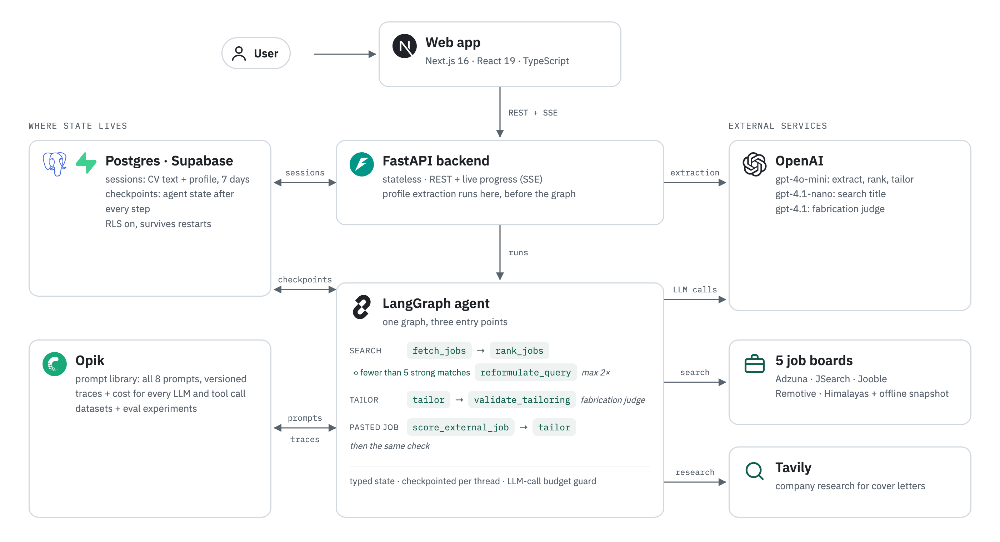
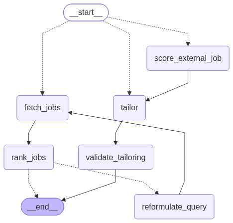

<div align="center">

<picture>
  <source media="(prefers-color-scheme: dark)" srcset="docs/images/logo-dark.png">
  
</picture>


### 🧭 An AI agent that finds jobs that actually fit — and tailors your CV without lying about it

<p>
  
  
  
  
  
</p>

</div>


---

## 🎯 What Joblyst does

Give it your resume. It **extracts a structured profile**, asks you **where you want to work**, **searches five live job boards concurrently**, **ranks every result against you with an LLM**, and — if the first pass comes back thin — **broadens the search and tries again**. Then, for any job you pick, it **tailors your CV and writes a cover letter**, and runs every generated claim through a **fabrication checker** before you see it, so nothing it writes says something your real CV doesn't back up.

It's a genuine multi-node **LangGraph agent**, not a prompt wrapper: typed state, conditional routing, checkpointed threads, per-node tracing, and a budget guard on LLM spend. It runs as a **FastAPI** backend with a **Next.js** web app that shows each search step live as it happens.

And it's **measured**. Every part of the pipeline that an LLM touches has an eval, a frozen dataset, and a number — and most of this README is the story of what those numbers found.

## ✨ Features

- 📄 **CV → structured profile** — `pypdf` extraction feeding an LLM that turns raw resume text into a typed `Profile` (seniority, roles, skills, projects, years of experience). Today's date is passed in, so "2022 – Present" is computed correctly.
- 🙋 **Preferences asked, not guessed** — where you want to work and whether you want remote are collected from you, because a CV records where you *have* worked, not where you *will*.
- 🔎 **Five-source concurrent job search** — JSearch, Adzuna, Remotive, Himalayas and Jooble queried in parallel, with a soft-deadline cascade so one slow source never blocks the fast ones, and an offline snapshot as the last resort.
- 🧠 **LLM-chosen search query** — the model picks the title, country and remote flag; a deterministic guard cuts any list of roles back to one searchable title.
- 📊 **Batched, parallel ranking** — every job scored 0–100 with matched skills and honest gaps, including a hard rule for experience gaps.
- 🔁 **Self-reformulating search** — under 5 jobs scoring 60+ means the agent picks an adjacent title and searches again, capped at two retries.
- 🧩 **Corpus-grounded tailoring** — your CV is split into small, verbatim, addressable units; every generated bullet must cite the real line it came from.
- 🛡️ **Two-stage fabrication check** — skills are checked by exact lookup; prose is checked by an LLM judge that is deliberately stronger than the model that wrote it, and only flags what a rewrite *adds*, never what it leaves out.
- 📈 **Opik for tracing, evals and prompts** — every LLM and tool call traced with cost; every prompt lives in Opik's prompt library, so a prompt can be edited and versioned there without touching code, and each eval run records the exact version it used.
- ⚡ **Live progress** — the search streams each step to the browser (Server-Sent Events): "Searched for 'Data Engineer': 10 jobs… Scored 10 jobs, 1 strong match…".
- 💾 **Sessions that survive restarts** — the uploaded CV, extracted profile and the graph's state are stored in Postgres (Supabase), so a redeploy doesn't lose anyone's work. Without a database, it falls back to memory.
- 📄 **Download the tailored CV as a PDF**, with each rewritten line shown next to the original CV line it came from.

## 🏗️ Architecture

### System overview

<picture>
  <source media="(prefers-color-scheme: dark)" srcset="docs/images/architecture-dark.png">
  
</picture>

### What happens on each request

| User step | Endpoint | What runs | What's stored |
|---|---|---|---|
| Upload CV | `POST /api/profile` | PDF → text (pypdf), then an LLM extracts a typed `Profile` | session row; returns a new `thread_id` |
| Search | `POST /api/search/stream` | agent: `fetch_jobs → rank_jobs`, broadening the search up to twice; each step is streamed to the browser as it finishes | checkpoint on the thread |
| Pick a job | `POST /api/tailor` | agent: `tailor → validate_tailoring`, reading the ranked jobs from the checkpoint | checkpoint |
| …or paste one | `POST /api/external-job` | agent: `score_external_job → tailor → validate_tailoring` | checkpoint |
| Download | `GET /api/tailor/{thread_id}/pdf` | renders the last tailored CV from the checkpoint (fpdf2) | — |

One `thread_id` ties it all together: the session row, the agent's checkpoints and the Opik trace thread all use it, so one user's whole journey shows up as one thread in Opik.

### The agent graph

<div align="center">

</div>

<sub>Rendered directly from the compiled graph (`get_compiled_graph().get_graph().draw_mermaid_png()`) — this is the actual topology, so it can't drift from the code.</sub>

Profile extraction runs once, before the graph. Three ways in, decided by `route_entry`: pasted job text → `score_external_job`; a `selected_job_id` → `tailor`; otherwise a normal search. `fetch_jobs` and `rank_jobs` loop through `reformulate_query` up to twice if fewer than 5 jobs score 60 or more, and every tailoring path ends in `validate_tailoring`.

One `StateGraph`, one checkpointer, three entry points — a search and a tailoring run share one thread, so tailoring reads the profile and ranked jobs straight from the checkpoint. Nothing re-runs.

### Design decisions

| Decision | Why |
|---|---|
| **Sessions are separate from checkpoints** | Profile extraction happens at upload, before the graph has ever run, so there's no checkpoint to keep it in yet. "Upload, then paste a job" never runs a search at all. |
| **Live progress over SSE**, and the 404 check runs *before* the stream | A search takes 30–60 s, so the user sees each step. Once a stream starts, "200 OK" is already sent, so an unknown `thread_id` is rejected in a FastAPI dependency first, which keeps it a real 404. |
| **Prompts live in Opik, not in code** | A prompt can be edited and versioned without a deploy, and each eval run records the exact prompt version it used. The SDK caches them; the server refuses to start if one is missing rather than failing a user's request. |
| **Tailoring can only reuse your CV** | The CV is split into small, verbatim pieces with ids, and every tailored bullet must cite the piece it came from, which gives the fabrication check something exact to compare against. |
| **A stronger model judges than writes** | `gpt-4o-mini` writes the CV, `gpt-4.1` checks it; a judge no better than the writer shares its blind spots. `gpt-4.1-nano` only picks the search title, the cheapest call. |
| **Every important prompt rule has code behind it** | A prompt is a request, not a guarantee: code cuts a list of job titles to one, caps LLM calls per run, and refuses to send a prompt with a missing value. |
| **Preferences come from the user** | A CV records where you *have* worked, not where you want to; locations and remote are asked on the form. |

---

## 🚀 Getting started

Works on macOS, Linux and Windows. About 10 minutes the first time.

### What you need

| | Why | Get it |
|---|---|---|
| **uv** | installs Python 3.12 and every dependency | [docs.astral.sh/uv](https://docs.astral.sh/uv/getting-started/installation/) |
| **Node.js 20.9+** | runs the web app | [nodejs.org](https://nodejs.org/) |
| **OpenAI API key** | every LLM call | [platform.openai.com/api-keys](https://platform.openai.com/api-keys) |
| **Opik API key** (free) | **required**: the app reads its prompts from Opik | [comet.com](https://www.comet.com/) |
| Job-board and Tavily keys | optional: more jobs, company research | links in `.env.example` |
| Postgres / Supabase | optional: keeps sessions across restarts | [supabase.com](https://supabase.com/) |

You don't need to install Python yourself; `uv` downloads the right version.

### 1. Get the code and install

```bash
git clone https://github.com/k-Rohit/Joblyst.git
cd Joblyst
uv sync --all-groups
```

### 2. Add your keys

```bash
cp .env.example .env          # Windows (cmd): copy .env.example .env
```

Open `.env` and fill in at least `OPENAI_API_KEY` and `OPIK_API_KEY`. Every other setting is explained in the file and can stay empty.

### 3. Put the prompts into your Opik

The app doesn't keep prompts in its code; it fetches them from Opik's prompt library at startup. A new Opik account has none, so copy them in once from `prompts/prompts.py`:

```bash
uv run python scripts/seed_prompts.py          # shows what it will add
uv run python scripts/seed_prompts.py --yes    # adds them
```

It only adds prompts your Opik doesn't have yet, so running it again never overwrites edits you made in Opik.

### 4. Check the setup

```bash
uv run python scripts/check_setup.py
```

You should see `Model replied: 'setup ok'` and the trace in your Opik project.

### 5. Start the backend

```bash
uv run uvicorn joblyst.api.main:app --reload --port 8000
```

Wait for `Application startup complete` (the first start takes a few seconds while it loads the prompts). If a prompt is missing or the Opik key is wrong, it stops here and says which.

### 6. Start the web app (second terminal)

```bash
cd frontend
npm install
cp .env.example .env.local    # Windows (cmd): copy .env.example .env.local
npm run dev
```

Open **http://localhost:3000**, upload a CV as a PDF (or try `data/fixture_cvs/data_engineer.pdf`), and follow the four steps.

### Optional: keep sessions in a database

Without `DATABASE_URL`, uploads and searches live in the server's memory and are lost when it restarts. To keep them:

1. Create a Postgres database. On Supabase, copy the **session pooler** connection string (port 5432), and use a password with only letters and digits: characters like `@` break the URL.
2. Run [`schema.sql`](schema.sql) once (Supabase: SQL editor).
3. Set `DATABASE_URL` in `.env` and restart the backend. LangGraph creates its own checkpoint tables on startup.

### If something goes wrong

| You see | Fix |
|---|---|
| `Prompts are stored in Opik, but Opik is not configured` | `OPIK_API_KEY` is empty in `.env` |
| `Could not fetch prompts from Opik: … API key is incorrect` | wrong key, or set `OPIK_WORKSPACE` |
| `Prompt '…' was not found in Opik's prompt library` | run step 3 with `--yes` |
| The web app shows a network or CORS error | the backend isn't on port 8000, or set `CORS_ORIGINS` in `.env` to the web app's address |
| Every search returns few jobs | add job-board keys in `.env`; without them only the keyless boards are searched |

There is also the original Streamlit test UI: `uv run streamlit run app.py`.

---

## 📊 Baseline → now, at a glance

Every number was measured on fixed, hand-checked data. The baseline is the first measurement; "now" is after the changes below.

| What's measured | Baseline | Now |
|---|---|---|
| Ranking: fit score on the right side of 60 (46 hand-labelled jobs) | 0.870 | **0.891** |
| Ranking: "matched skills" really in the CV | 0.978 | **0.978** |
| Profile extraction: field accuracy (5 hand-checked CVs) | 0.569 | **0.738** |
| Fabrication: share of generated claims flagged (14 tailored CVs) | 0.388 | **0.104** |

**What changed, by type of optimisation**

| Type | What I did | Effect |
|---|---|---|
| **Fixing the input, not the prompt** | The ranker was sent an empty profile on every normal search (one mis-indented `return`); now a blank prompt input raises instead | Every fit score before this was guessed blind |
| **Prompt rules** | Extraction: count only *paid, relevant* years and pass in today's date. Ranking: a hard rule for experience gaps. Search: one job title, never a list | Years 11 → 2 for a career changer; 2.0 → 4.0 for a current job; one query firing 16 searches → 2 |
| **Few-shot examples** | The fabrication judge got one plain rule ("flag only what the rewrite *adds*") plus 8 worked examples from unrelated domains | Same 45 claims, still flagged: 40 → 32 |
| **A stronger model where it matters** | The judge is `gpt-4.1`, stronger than the `gpt-4o-mini` that writes the CV | 32 → **7** of 45 still flagged, all 7 real |
| **The right tool for each check** | Text similarity kept only for skills (exact matching works); all sentences go to the judge | Flag rate 0.235 → **0.104** |
| **Asking the user instead of guessing** | Locations and remote preference moved out of the CV extraction into the form | Extraction stopped inventing roles; `primary_roles` 0.62 → 0.77 |
| **Deterministic guards behind prompts** | Code cuts any list of roles to one title; a reformulation round searches exactly the chosen title instead of asking an LLM again | A broader search now really searches the broader title |
| **Fixing the eval itself** | The ranking replay forgot the user's target role; stored and replayed it | 0.870 → 0.891 without touching the model |
| **Measured, then dropped** | `gpt-4.1-mini` as judge, `gpt-5-mini` for extraction, Opik's automatic prompt optimiser, a "description is cut off" rule, a reasoning field | Each was worse or no better; see chapter 7 |

The rest of this section is the full story behind each row.

## 🔬 The eval story

This is the part I'd want someone to read. Joblyst worked end to end long before it was *right*, and the only way I found that out was by measuring it.

### The scoreboard

| What's measured | How | First number | Now |
|---|---|---|---|
| **Ranking** — is the fit score on the right side of 60? | 46 hand-labelled jobs, deterministic check | 0.870 | **0.891** |
| **Ranking** — are "matched skills" real? | same 46, exact lookup | 0.978 | **0.978** |
| **Profile extraction** — field accuracy | 5 hand-verified CVs, deterministic | 0.569 | **0.738** ¹ |
| **Fabrication** — share of generated claims flagged | 14-case tailoring batch | 0.388 | **0.104** ² |
| **Routing, query guards, API, corpus** | unit tests, no LLM, no API keys | — | **36 passing**, under 1s |

<sub>¹ Partly arithmetic — two fields that a CV cannot answer were moved out of extraction entirely. The real gain is in one field; see chapter 4.<br>² Read by hand, about 21 of the 38 flags are real, so the true rate is about <b>5.8%</b>. Most of the rest come from the judge being shown the wrong CV lines; see chapter 6.</sub>

Every number above came out of a story that looked like this: *the app seemed fine → a measurement disagreed → I read the raw outputs → found the real cause → changed one thing → measured again → kept it or reverted it.* The full record, with every symptom, cause, fix and result, is in [`docs/engineering_log.md`](docs/engineering_log.md).

---

### Chapter 0 — Where it started

By mid-September the agent did everything on the feature list. You could upload a CV, get a ranked list of jobs, pick one, and get a tailored CV back. It looked good.

The problem was that "looked good" was the only evidence. Nothing told me whether a fit score of 85 was right, whether the profile extraction was accurate, or whether the tailored CV was honest. Every output was plausible, and plausible is exactly what an LLM produces whether it's right or not.

### Chapter 1 — Turning the lights on: tracing

The first step was observability: Opik tracing on every node, every LLM call and every job source, with cost. Before measuring anything formally, I just read real traces.

**The first trace I read found the worst bug in the project.** A Senior Data Scientist role needing 4+ years scored **85** for a candidate with 1.5 years, with an explanation that hedged like a coin flip: *"the candidate's specific years of experience were not provided."*

They had been provided. The cause was one misplaced line in `rank_jobs.py`:

```python
def _render_profile(profile, target_role=None):
    base = f"Name: ...\nYears experience: {profile.years_experience}\n..."
    if target_role:
        base += "\nNote: candidate is deliberately targeting..."
        return base        # <- indented one level too far
    return ""              # <- every normal search hit this
```

Every normal search sent the ranker an empty profile. **Every fit score ever produced on a plain search had been generated with no information about the candidate** — and it never errored, because an LLM given nothing doesn't refuse, it invents something plausible.

That changed how I built everything after it. A hollow prompt is worse than a crash, so required prompt inputs now fail loudly:

```python
assert rendered_profile, "rank_jobs: profile rendered empty — refusing to rank blind"
```

I verified the guard fires by reintroducing the original bug on purpose.

### Chapter 2 — Building something to measure against

You can't measure without data you trust. Five pieces:

1. **Fixture CVs.** Five synthetic India-based CVs, deliberately different in structure — a junior data scientist, a senior ML engineer, a teacher pivoting into data, a remote-friendly lead, a mid-level analyst — plus my own real CV. The first batch had been built for the wrong country (London, Berlin, Austin) for an app that only searches India, so they were regenerated.
2. **An offline job snapshot.** 99 real postings saved to disk, so evals don't burn job-board quotas (Jooble allows 500 requests for the *lifetime* of a key) and can be re-run.
3. **Human labels.** I labelled 46 ranking items by hand (was the score right?) and wrote 5 expected profiles field by field. The human owns the labels; the model never writes ground truth.
4. **Two kinds of truth.** Some things are checkable by code — is this skill in the CV, is the score above 60. Others need judgment — is this sentence an exaggeration. The rule: **use code wherever code can answer, and only use an LLM judge for what genuinely needs one.** Most of this suite is deterministic, and that's deliberate.
5. **Versioned prompts.** Every prompt is registered in Opik's prompt library, so each experiment records exactly which prompt text produced it.

### Chapter 3 — Ranking

**The eval.** Replay only the ranking step on each frozen (profile, job) pair with the current prompt, and check two things: is the score on the side of 60 my label says it should be, and are the "matched skills" really in the profile.

**First run: 0.870.** Three of the six misses were jobs for my own CV, all scoring 15–40 points lower than in the original run.

**The bug was in the eval, not the model.** That original run had been a deliberate pivot — my data-engineering CV searching for AI Engineer roles — and the ranker had been told so. The dataset never stored that, so the replay ranked AI roles for a plain data engineer and called it a regression. Storing `target_role` in each item and replaying it brought the score to **0.891**. The lesson: an eval is only fair if it replays the situation the label was made for.

**Then I measured the noise** before trusting any difference. Two runs of the same prompt on 39 items: 36 identical scores, the largest change 10 points, and one item crossing the 60 line. So a one-item swing is noise, not a finding.

**A data limit I couldn't fix.** Adzuna's free API returns only the first **500 characters** of every description — confirmed with a live call, 10 of 10 results — and the full pages return HTTP 403 to scripts. So the ranker never sees a "5+ years required" past that point. I tried a prompt rule telling it the text was cut off and to judge seniority from the title instead. It fixed 2 misses and broke 2 others (it started treating "the text is cut off" itself as a reason to lower scores). Net change: zero. **Reverted**, and logged as a known limitation of free data.

### Chapter 4 — Profile extraction

The profile drives everything downstream: its `primary_roles` become the search query, its `years_experience` feeds the ranker's experience-gap rule. It had never been measured.

**First run: 0.569**, and six real defects nobody had noticed. Each one taught something different.

**`languages` was 0.000 on every CV** — and nothing anywhere ever read the field. **Removed entirely** rather than fixed.

**`primary_roles` was transcribing job history, not searchable roles.** For a junior data scientist it returned `['junior data scientist', 'data science intern', 'undergraduate research assistant']`. Since the first entries become the fallback search query, that searched for internships. The prompt contradicted itself — "roles this person is a fit for" (forward) "ordered with their most recent first" (backward). Rewritten to say what the field is *for*. Result: 0.55 → 0.62, with 3 CVs improving and 2 regressing — a trade, not a clean win.

**A teacher's 11 years were counted as 11 years of data experience.** And it mattered more than one wrong field:

```
Business Data Analyst, VOLTO   — posting requires "8-12 years"
candidate years: 11   ->  model score 60   ->  clears the good-fit bar
explanation: "requires 8-12 years, which is at the upper limit of her experience"
```

The ranker's experience-gap rule *inverted*: fed 11, it confirmed a senior role fit a career changer with almost no data experience. That job was one of the six I'd labelled wrong in the ranking review. **One extraction bug, showing up as a failure in two different evals** — and the ranking eval couldn't diagnose it, because ranking an 11-year candidate against an 8–12 year role at 60 is correct reasoning on bad input. Fixed to count only paid experience in the relevant field: 11 → 2.

*This was a regression by the metric* (0.697 → 0.656), because my label says `None` and 2 still scores zero. **I kept it anyway** — the metric is binary and can't see that the real harm, the inverted ranking, is gone. Choosing against the number, and writing down why, felt like the honest call.

**`locations` and `remote_ok` could never be right**, because a CV doesn't contain them. "Open to hybrid" — remote or not? Four cities listed — are those past offices or preferences? The model was being graded on a question the document doesn't answer. **Moved out of extraction entirely**: the app now asks the user. The score jumped to 0.738, but I'm explicit that most of that is arithmetic from dropping two bad fields. The real gain was a side effect: with those removed, `primary_roles` stopped inventing roles like `data architect` and `ml platform lead`, going 0.62 → 0.77.

**The model thinks it's October 2023.** One CV failed `years_experience` in every run no matter what I changed. It turned out to be the only CV without a line like "8 years of experience", so the model had to compute from dates — and asked directly, gpt-4o-mini answers *"Today's date is October 4, 2023."* Every "2022 – Present" was being counted to 2023. Four of five fixtures hid this by stating their years in prose, but in production it would understate **every CV with a current job**. Fixed by passing the real date in: 2.0 → 4.0.

**What that exposed, and what I left open.** 4.0 is only the *current* role; the honest answer is 5. I tried three fixes — an explicit "add up every role" rule, a near-identical worked example, and a reasoning field in the schema — and none worked. Asked the same question free-form with "show your work", the model gets 5 correctly. Through structured output, it won't. **It reads dates reliably and adds them unreliably.** The real fix is to have the model extract the date ranges and compute the total in Python. Deferred, and written down.

### Chapter 5 — Search queries and routing

**Routing** is plain Python — same state, same branch, every time — so it gets **unit tests, not an eval**. 14 tests pin the decisions that could silently break, like whether exactly 60 counts as a good score. To check the tests have teeth, I wrote three deliberately broken versions of the routers; all three were caught.

**A search query matched nothing at all.** A trace showed the agent searching for:

```
'Data Analyst OR Business Analyst OR'
```

No job is titled that. The LLM had returned a 7-word list; the guard cut it to 6 words by count, leaving a dangling `OR`. Fixed by splitting on list separators *before* cutting by length, so it becomes `'Data Analyst'`. Slashes and ampersands are deliberately kept, because `AI/ML engineer` and `R&D engineer` are real single titles.

**Then one LLM call fired 16 job searches.** The cause was a different node. The query-broadening step had no rules about shape, so it produced:

```
'Data Analyst OR Business Analyst OR Analytics OR Data Scientist OR ...
 OR SQL OR Excel OR Looker OR Python OR DBT OR Snowflake OR Tableau ...'
```

16 terms. The search step obediently issued **one search per term**, including `SQL` and `Excel`, which are skills, not job titles. That case made ~32 searches and found the *fewest* jobs of any — because "broader" had been implemented as "more terms", and a list matches no posting. Given the same one-title rule as the search step: **16 tool calls → 2**.

**The broader search never searched the broader title.** No eval caught this; the web app did. Once the search streamed its progress live, every run showed the same contradiction:

```
Not enough strong matches, trying 'data architect'
Searched for 'data engineer': 20 jobs so far      <- the old title, searched again
...
Searched for 'data engineer': 20 jobs so far      <- third round: 0 new jobs
```

The broadening step did its job and set `search_query = "data architect"` in the graph state. But the search step never searched that field. It passed it to its own LLM as a *suggestion* ("use this broader query"), searched whatever that LLM wrote, and saved the LLM's choice back to `search_query`, overwriting the broader title. Tested on its own with the round-2 inputs, the search LLM ignored the suggestion **5 times out of 5** and wrote "Data Engineer", exactly what it writes with no suggestion at all. So every extra round cost an LLM call, the job-board calls and a ranking pass, mostly to repeat the first search.

The fix takes the LLM out of that step: a broadening round now searches **exactly** the title the broadening step chose. On the same search, round 2 really searched **'Data Architect'** and added 10 new jobs, with one LLM call fewer per round. A unit test pins it: given a broadened title, the search step must use it and must not call an LLM.

**It also showed the next problem: already-searched titles come back.** In that same run, round 3 went *back* to 'Data Engineer', the first title, and added nothing. The broadening step is only told the *last* title it tried, so it can't know 'Data Engineer' was already searched, and the obvious "broader" neighbour of Data Architect is Data Engineer. The fix is under way: the graph state now keeps a `searched_queries` list (every title searched in this run, reset for each new search), and the next step is to show it to the broadening prompt as "don't repeat these", and to stop searching instead of repeating one if the model suggests it anyway.

### Chapter 6 — The fabrication check

Every tailored CV is checked before you see it: does each line say only what your real CV supports?

**What was happening.** The first batch flagged **39%** of all generated claims (144 of 371), so every tailored CV looked untrustworthy. Reading the flags by hand, almost none were inventions. The checker was wrong, not the writer, for three reasons:

1. **The cheap similarity check punished honest shortening.** It flags any line too different in wording from its source, so a faithful summary scored low:
   ```
   real CV : Migrated a critical Airflow DAG delivering company/account data to
             Salesforce CRM into a Databricks workflow, reducing latency by 40%.
   rewrite : Migrated critical workflows from Airflow to Databricks, reducing
             data processing latency by 40%.          -> similarity 0.55, FLAGGED
   ```
2. **The LLM judge flagged what was left out**, which its prompt said was fine, and once even called a removed word an *addition*.
3. **The CV parser split sentences in half** (`"...at a p99 latency of"` / `"45ms."`), so the judge was correctly told "45ms" wasn't in the line it was shown.

**How it was fixed.**
- The similarity check now only checks **skills**, where exact matching is the right tool. Every sentence goes to the LLM judge.
- The judge got one plain rule, *flag only what the rewrite adds; leaving things out is fine*, plus 8 worked examples from unrelated domains, so a re-run can't pass by memorising the real claims.
- The judge became **`gpt-4.1`**, stronger than the `gpt-4o-mini` that writes the CV: a judge no better than the writer shares its blind spots.
- The parser now treats a line starting with a digit as a continuation.

**The numbers** (same 14-CV tailoring batch each time):

| | Claims flagged | Rate | Check time per CV | Judge cost, 14 CVs |
|---|---|---|---|---|
| Baseline | 144 / 371 | 0.388 | 1.7 s | — |
| New judge prompt + `gpt-4.1` | 90 / 383 | 0.235 | 4.1 s | $0.25 |
| **+ similarity check on skills only** | **38 / 364** | **0.104** | **5.8 s** | **$0.41** |

Reading all 38 by hand, about **21 are real**, a true rate of about **5.8%**. They're mostly vague, flattering padding ("demonstrating strong analytical skills"), two invented facts about the hiring company, and one number distortion, exactly what the check exists for: the CV said 19 of 23 flagged students were correct; the letter said 23. On the judge alone, the same 45 claims went from 40 still flagged to **7, all real**. In 218 judge calls there were zero rate-limit errors.

**What's left.** Most of the ~17 false flags have one cause: the summary and cover letter don't cite a source line, so the judge is shown the 3 CV lines that *look* most similar, and `difflib` often picks the wrong ones. Embeddings ranked the proving line **#1** in all three cases tested, where `difflib` had it at #16–#24. That's tested but not wired in yet. The full story, with every intermediate step, is in [`docs/engineering_log.md`](docs/engineering_log.md).

### Chapter 7 — What I tried and didn't keep

Knowing what *not* to keep is half of this. Each was measured before it was dropped:

| Tried | Result | Decision |
|---|---|---|
| `gpt-4.1-mini` as the fabrication judge | 17 / 45 still flagged vs 7 / 45 for gpt-4.1, the extra 10 mostly false | **Rejected** — cheaper and 6.7× more rate-limit headroom, but it re-creates the false alarms |
| Opik's automatic prompt optimizer on extraction | one run 0.648 → 0.711, the next run found nothing; its rewrites dropped my domain rules | **Not adopted** — 5 examples is far too few for it to tell signal from noise |
| `gpt-5-mini` for extraction | 0.553 vs 0.656, and 4.5× slower | **Rejected** — it produced roles like `data analyst (mid)` that break the search query |
| A "description is cut off" ranking rule | fixed 2, broke 2, net 0 | **Reverted** |
| A reasoning field to make the model add up years | made it worse (4.0 → 3.5) | **Reverted** — move the arithmetic into code instead |

One honest note on the metric itself: `gpt-5-mini` lost points on `skills` partly for being *right* — it added `flask` and `streamlit`, which are in the CV but missing from my label. A metric is only as good as its labels.

### What I'd say I learned

- **Read the raw outputs before trusting a number.** The 39% fabrication rate was real arithmetic about the wrong thing.
- **An LLM never refuses for lack of context** — it invents. Required inputs must fail loudly.
- **A bug often shows up somewhere other than where it lives.** The worst ranking error came from extraction; the worst search fan-out came from the reformulation node.
- **Keep arithmetic out of the model as much as possible especially if using some older models.** Both date bugs were arithmetic.
- **Ask the user for what the document can't contain.**
- **A prompt is a request, not a guarantee.** Every prompt rule that matters has a deterministic guard behind it.

## ▶️ Running the evals

```bash
# fast, offline, no API keys needed
uv run pytest tests/ -q

# replay ranking on the 46 labelled items (needs OPIK_API_KEY)
uv run python -m evals.run_evals --suite ranking --yes

# re-extract the 5 fixture CVs and score them field by field
uv run python -m evals.run_evals --suite extraction --yes
uv run python -m evals.run_evals --suite extraction --yes --model openai:gpt-5-mini

# search + tailor 14 cases and report the fabrication rate (~$0.30)
uv run python scripts/run_tailor_batch.py --yes
```

Every script prints its plan and estimated cost and stops unless you pass `--yes`.

## 🧰 Tech stack

| Layer | Choice |
|---|---|
| Agent orchestration | **LangGraph** + **LangChain** |
| Backend | **FastAPI**, with Server-Sent Events for live search progress |
| Web app | **Next.js** 16 + React 19 + TypeScript |
| Database | **Postgres** (Supabase) via psycopg 3: sessions + LangGraph checkpoints |
| LLMs | OpenAI — `gpt-4o-mini` for extraction, ranking and tailoring; `gpt-4.1-nano` for search queries; **`gpt-4.1` as the fabrication judge** |
| Observability, evals & prompts | **Opik** — traces, spans, cost, datasets, experiments; the prompt library is where the app's prompts live |
| Data validation | **Pydantic v2** |
| Job sources | JSearch, Adzuna, Remotive, Himalayas, Jooble, plus an offline snapshot |
| Company research | Tavily |
| PDF | pypdf (reading CVs), fpdf2 (writing the tailored CV) |
| Testing | pytest |
| Config | pydantic-settings (`.env`-driven) |
| Package/runtime | Python 3.12, [`uv`](https://docs.astral.sh/uv/) |


Built by following [jamwithai/observable-job-agent](https://github.com/jamwithai/observable-job-agent) to learn production LangGraph patterns firsthand — then diverging where the evidence pointed somewhere better: extra job sources, user-supplied preferences, a hand-labelled extraction eval, and a fabrication judge rebuilt after measuring how often the original one was wrong.

---

<div align="center">
<sub>Built with LangGraph, Opik, and a habit of measuring every design decision before trusting it.</sub>
</div>
